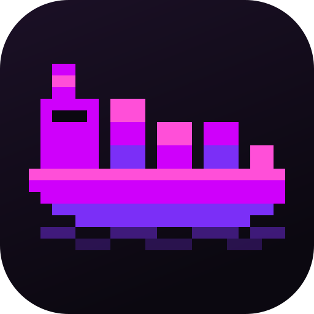
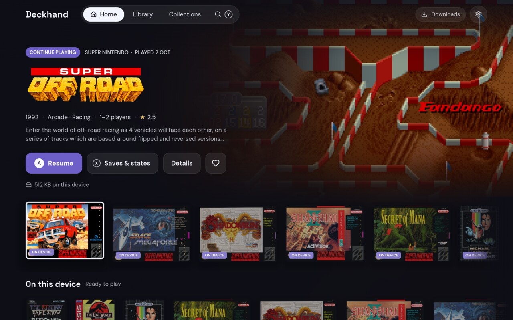
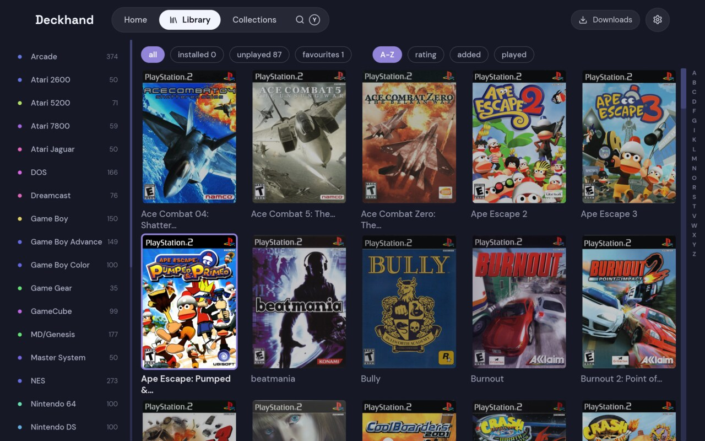

> [!IMPORTANT]
> **This entire project is vibe-coded with AI assistance.** The code is built iteratively through prompting, testing, debugging and refinement rather than through a traditional from-scratch coding workflow.


<p align="center"></p>

# Deckhand

A gamepad-first companion for the [RomM](https://romm.app) ROM manager, built for the Steam Deck.
Browse your library from the couch, download games onto the device, play them through [RetroDECK](https://retrodeck.net),
and keep saves and save states in sync with your server.



## Features

- **Pairing without a keyboard.** Scan a QR code with your phone and approve Deckhand in RomM, or
  type a pairing code.
- **Home.** A spotlight on the last played game, press A to play and
  X to check the games saves. Below it are sections for *Continue playing*, *On this device*, your RomM *Now
  playing*.
- **Library and Collections.** Every system or collection as a cover grid, with filters, sorting and
  an A–Z jump. Your favourites and your own collections are a chip each, and RomM's genres,
  franchises and series are browsable across systems.
- **Search.** Ranked search across every system, by title and by other names, so `ff7` finds
  *Final Fantasy VII*. An on-screen keyboard makes it work with a gamepad.
- **Game pages.** Art, rating, How Long to Beat, regions and builds, and the game's
  RetroAchievements, with the ones you have earned marked. *Favourite* marks it in RomM.
- **Downloads.** A queue that survives restarts, unpacks archives, writes an `.m3u` for multi-disc
  games and fetches the BIOS. A game's update and DLC come with it, and its other extras on RomM
  (a manual, a hack, a translation) are on its page under *Extras*. Games can go to any drive (an
  SD card, for instance), with an optional space budget. Games already in the folder are found and
  count as downloaded. With RomM 5.4 and a QR pairing, a game can be sent to the Deck from RomM's
  web app with *Install on device*.
- **Playing.** Games start through [RetroDECK](https://retrodeck.net), a command of your own, or an emulator picked per
  system, such as a PCSX2 you installed yourself. They can resume from their newest save state, and
  *Resume from the newest state* decides that for the games Deckhand starts, whatever RetroArch's
  own *Auto Load State* is set to. RomM 5.4's web app shows the game as being played on the Deck.
- **Save sync.** Saves and save states sync both ways through RomM: around every launch, and while
  the window is open, as soon as a save changes. An older save can be restored from a game's Saves
  page, and a save state there put into a slot. See [Save sync](#save-sync) for what each system syncs.
- **Steam and ES-DE.** Downloaded games can be added to Steam with their art, and still sync when
  started there. Games started from ES-DE sync too, through hooks Deckhand installs. Add Deckhand
  itself to Steam as a non-Steam game and it gives itself a cover, banner, logo and backdrop.
- **Made for a gamepad.** The d-pad reaches every page and button, and L1/R1 move between tabs.
- **Updates itself** from this repository's releases.

## Save sync

Saves go through [argosy-sigil](https://github.com/rommapp/argosy-sigil), RomM's own save library:
it reads each game's id off its disc and finds that game's saves in the emulator's folders, even on a
memory card every game shares. A game's saves travel as one file in its `autosave` slot, in the same
shape RomM's Android app syncs. Saves put on RomM by earlier versions of Deckhand are read and moved
over on each game's first sync. A client that keeps a game's save in a slot of its own, such as
`battery`, is followed there: like RomM's web player, Deckhand goes on in whichever slot holds the
newest version of the save, and leaves the slot it came from as it is.

Save states are RetroArch's slots, one to one: slot 0, every numbered slot however many there are,
and the auto slot are each one state on RomM, under a name that says the slot and the core. Saving
into a slot again replaces its state on RomM, so a slot is the same on every device that runs the
game under that core. Deckhand never deletes a save state on RomM; that is yours to do, on RomM's
own pages, and a state deleted on either side is not brought back by the other. A state on RomM that
is in no slot here, such as one saved in RomM's web player, can be put into one from the game's Saves
page.

| Platform | Emulator | What syncs |
|---|---|---|
| Everything RetroArch runs | RetroArch, any core | ✅ Saves and save states, memory cards and backup RAM included |
| PlayStation 2 | PCSX2 | ✅ The game's saves off a folder or file memory card, save states |
| PSP | PPSSPP | ✅ Save folders, save states |
| PlayStation | DuckStation | ✅ Memory cards, save states |
| PlayStation 3 | RPCS3 | ✅ Save folders |
| PS Vita | Vita3K | ✅ Save folders |
| GameCube | Dolphin | ✅ Memory card saves, save states |
| Wii | Dolphin | ✅ Saves, save states |
| Wii U | Cemu | ✅ Saves |
| 3DS | Azahar | ✅ Saves and extra data |
| Switch | Ryubing, Eden | ✅ Saves, each user's and the ones the console shares, which move between the two |
| Xbox, Xbox 360 | — | ❌ Not synced yet |

A Switch game is known by the id inside its NSP or XCI, which reading takes the `prod.keys` you gave
Ryubing (`system/`) or Eden (`keys/`); without them, by an id in its file name, such as
`Game [0100ABCD12345000].nsp`. Neither ships with RetroDECK, so set the one you installed under
*Emulator for each system*.



## Getting started

Download the AppImage (Linux, Steam Deck) from
[Releases](https://github.com/mathmahan/deckhand/releases), then run it:

```sh
chmod +x Deckhand-*-x86_64.AppImage
./Deckhand-*-x86_64.AppImage
```

You need a [RomM](https://docs.romm.app) server, 5.3 or later for QR pairing. To see which version
yours runs:

```sh
curl -s https://romm.example.com/api/heartbeat | jq -r .SYSTEM.VERSION
```

Games play through [RetroDECK](https://retrodeck.net). Install it from Flathub, then open it once to set it up:

```sh
flatpak install flathub net.retrodeck.retrodeck
```

To assign a system its own emulator, such as a PCSX2 you installed yourself, use Settings ▸ Playing ▸
*Emulator for each system*. Choose the emulator (a program, an AppImage, or a Flatpak) and
Deckhand fills in the usual options for it:

```sh
# PlayStation 2, with the PCSX2 AppImage
/home/deck/Applications/pcsx2-v2.2.0-linux-appimage-x64-Qt.AppImage -batch {rom}

# GameCube, with the Dolphin Flatpak
/var/lib/flatpak/exports/bin/org.DolphinEmu.dolphin-emu -b -e {rom}

# Switch, with the Eden AppImage
/home/deck/Applications/Eden-Linux-v0.2.0-amd64.AppImage -f -g {rom}
```

Saves sync for RetroArch, and standalone emulators: PCSX2, DuckStation, Dolphin, PPSSPP, RPCS3, Vita3K, Azahar,
Cemu, Ryubing and Eden — see [Save sync](#save-sync).

## Building

Save sync is built on [argosy-sigil](https://github.com/rommapp/argosy-sigil), a C library kept as a
git submodule, so a build needs it checked out, and CMake and a C compiler to build it:

```sh
git submodule update --init --recursive
cargo run                      # the app
cargo run -- --fixtures=60     # 60 made-up games, no server needed
cargo test
packaging/build-appimage.sh    # AppImage, built in Docker
packaging/build-windows.sh     # Windows .exe, cross-compiled in Docker
```

## License

MIT — see [LICENSE](LICENSE). Releases up to and including 0.9.4 were published under GPL-3.0, and
stay under it. DM Sans and Space Grotesk are under the SIL OFL 1.1
([DM Sans](fonts/OFL.txt), [Space Grotesk](fonts/OFL-SpaceGrotesk.txt)) and the Lucide icons under
ISC. Bundled game data is credited in [ATTRIBUTIONS.md](ATTRIBUTIONS.md). The AppImage carries the
notices of everything built into it in `usr/share/doc/deckhand/THIRD-PARTY-LICENSES.md`, which
[packaging/licences.sh](packaging/licences.sh) writes from `Cargo.lock` and the files above.
