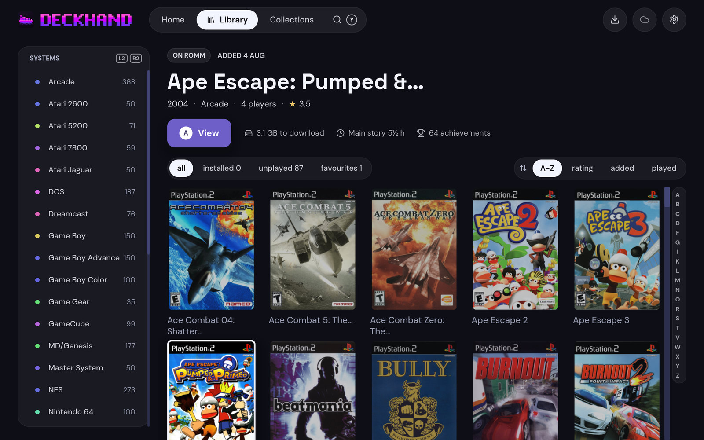
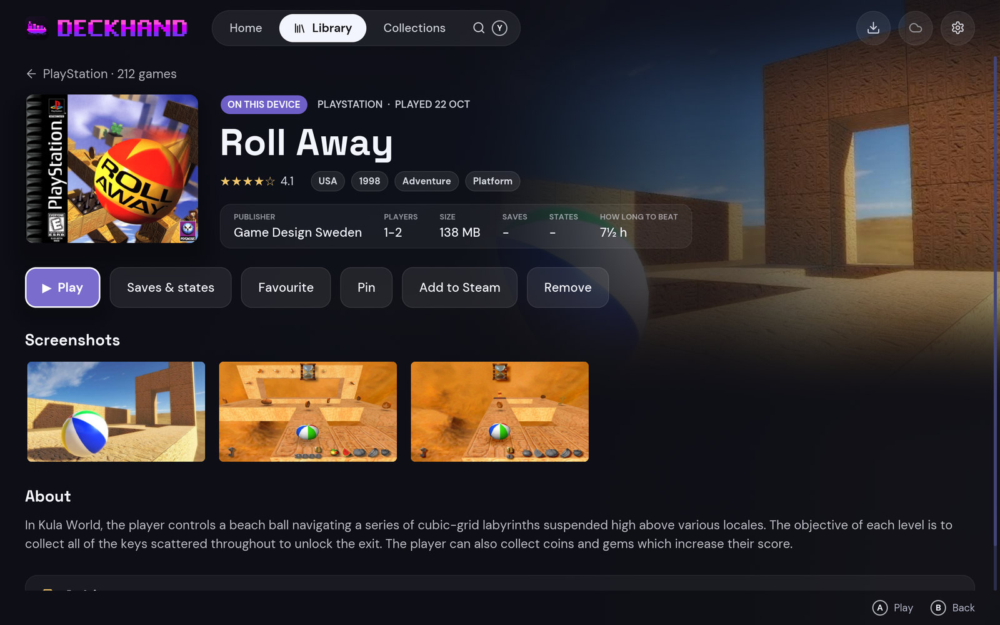

> [!IMPORTANT]
> **This entire project is vibe-coded with AI assistance.** The code is built iteratively through prompting, testing, debugging and refinement rather than through a traditional from-scratch coding workflow.


<p align="center"></p>

# Deckhand

A gamepad-first companion for [RomM](https://romm.app) on the Steam Deck: browse your library from
the couch, download games, play them through [RetroDECK](https://retrodeck.net), and keep your saves
in sync.


<p>
  
  
</p>

## Features

- Pair by QR code, no keyboard needed
- Every system and RomM collection as a cover grid, and search across them all
- Downloads to any drive, with multi-disc games, BIOS, updates and DLC taken care of
- Play through RetroDECK, or an emulator of your own for each system
- Saves and save states synced both ways, around every launch and as they change
- Add games to Steam; games started from ES-DE sync too
- Made for a gamepad, and updates itself

## Save sync

| Platform | Emulator | What syncs |
|---|---|---|
| Everything RetroArch runs | RetroArch, any core | ✅ Saves and save states, memory cards and backup RAM included |
| PlayStation 2 | PCSX2 | ✅ The game's saves off a folder or file memory card, save states |
| PSP | PPSSPP | ✅ Save folders, save states |
| PlayStation | DuckStation | ✅ Memory cards, save states |
| PlayStation 3 | RPCS3 | ✅ Save folders |
| PS Vita | Vita3K | ✅ Save folders |
| GameCube | Dolphin | ✅ Memory card saves, save states |
| Wii | Dolphin | ✅ Saves, save states |
| Wii U | Cemu | ✅ Saves |
| 3DS | Azahar | ✅ Saves and extra data |
| Switch | Ryubing, Eden | ✅ Saves, each user's and the ones the console shares, which move between the two |
| Xbox, Xbox 360 | — | ❌ Not synced yet |

For Switch, pick Eden or Ryubing in Settings ▸ Playing ▸ *Emulator for each system*. Keys and
firmware uploaded to RomM's Switch platform are put in place for it.

## Getting started

Download the AppImage from [Releases](https://github.com/mathmahan/deckhand/releases) and run it. You
need a [RomM](https://docs.romm.app) server, 5.3 or later for QR pairing. Deckhand offers to install
RetroDECK when it isn't there.

## Building

```sh
git submodule update --init --recursive   # argosy-sigil: needs CMake and a C compiler
cargo run -- --fixtures=60                # made-up games, no server needed
cargo test
packaging/build-appimage.sh
```

## License

MIT — see [LICENSE](LICENSE); releases up to and including 0.9.4 stay under GPL-3.0. DM Sans and
Space Grotesk are under the SIL OFL 1.1 ([DM Sans](fonts/OFL.txt),
[Space Grotesk](fonts/OFL-SpaceGrotesk.txt)), the Lucide icons under ISC, and bundled game data is
credited in [ATTRIBUTIONS.md](ATTRIBUTIONS.md).
